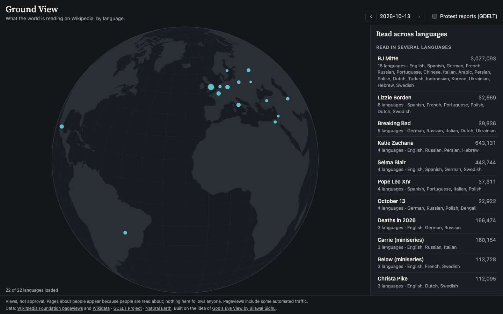

# Ground View

What is the world reading today? Ground View puts yesterday's most read Wikipedia articles in 22 language editions on a globe, each pinned to a place where the language is spoken. It shows what each language community is reading on its own, and which articles are being read across many languages at once.

**Live demo:** [himanshukalra.com/groundview](https://himanshukalra.com/groundview/)

## Why I built it

I am a UX researcher, and most of my work is about how people make sense of complicated systems. Wikipedia's reading figures are one of the few honest, public, daily records of what large groups of people are curious about. Comparing languages side by side shows how differently the same day looks from different places, and how rarely a story crosses most of them.

Ground View started as a much larger fork of [God's Eye View](https://github.com/bilawalsidhu/gods-eye-view) by Bilawal Sidhu and Sameh Khamis, which puts planes, ships and satellites on a 3D globe. I pointed it at people instead, with ten layers on protest, migration, values and more. It was interesting but hard to read, so I cut it down to the one question that worked best. The full version is kept on the [`archive/full-v1`](https://github.com/uxhimanshuk/ground-view/tree/archive/full-v1) branch, and [docs/ARCHIVE.md](docs/ARCHIVE.md) describes what it had.

## How to read it

- **Pins** mark the 22 largest Wikipedia editions. A bigger pin means more reading of that edition's top articles.
- **Read in several languages** lists articles that appear in the top 25 of two or more editions on the same day. Articles are matched across languages through Wikidata, so the German and Japanese pages about the same subject count as one.
- **Only here** shows, for each language, its most read article that no other edition has in its top 25.
- **Protest reports** is an optional faint layer of news reports about protests in the last 24 hours, from the GDELT Project. It is there for context, not as a measurement.
- The date steps back one day at a time. The link in the address bar opens the same day and language for anyone you send it to.

## What the data cannot tell you

- Views are not approval. An article can be read because people are worried, curious or angry.
- Pageviews include some automated traffic, and the lists are shown unfiltered, so they sometimes include explicit articles or articles about living people. They are aggregate reading behaviour. Nothing here follows a person over time.
- Each language is pinned to one place for legibility. English is read everywhere but sits in England; Spanish sits in Mexico City.
- GDELT protest reports are machine-coded from news. A place can be wrong, one event can be counted several times, and places with less press coverage look quieter than they are.

## How it works

It is a single static page with no build step. The browser fetches reading figures directly from the Wikimedia pageviews API and resolves titles through the Wikipedia API. The globe is drawn with d3-geo on Natural Earth outlines. Protest reports come from a small script, run hourly by GitHub Actions, that reads GDELT's event files and publishes one JSON file to the `snapshots` branch.

To run it locally, serve the folder with any static server, for example `python3 -m http.server`, and open the address it prints. `npm test` runs the tests on Node 24 and needs no install.

## Credits

Reading data from the Wikimedia Foundation pageviews API and Wikidata. Protest reports from the GDELT Project. Land outlines from Natural Earth. The original idea and the earlier engine come from God's Eye View by Bilawal Sidhu and Sameh Khamis, under the MIT licence, which this repository keeps.
