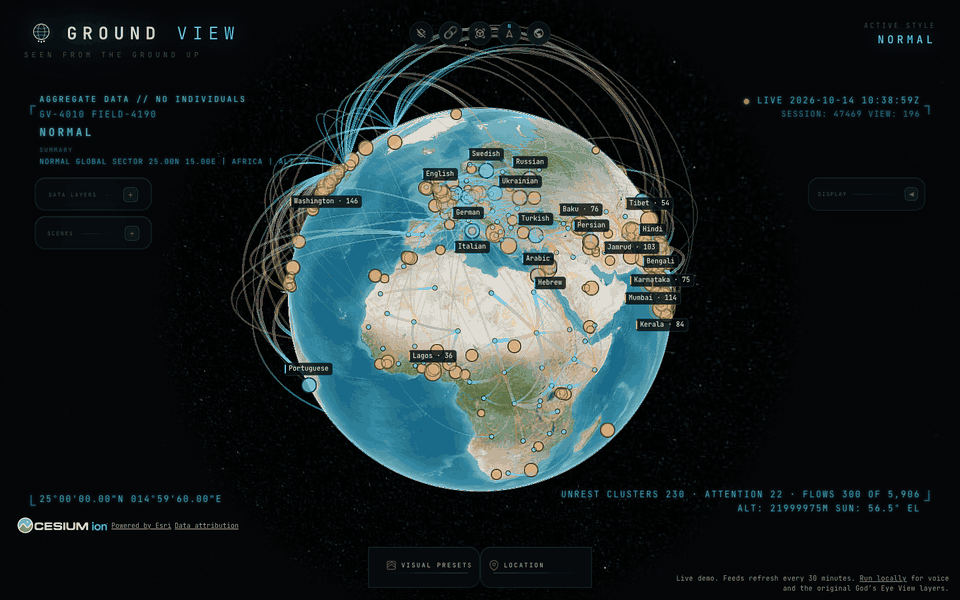

# Ground View

A live globe of what societies are doing: where people are protesting, what each language community is reading, where people have moved, and how countries differ in income, age and values. It is a fork of [God's Eye View](https://github.com/bilawalsidhu/gods-eye-view) by Bilawal Sidhu and Sameh Khamis, which puts planes, ships and satellites on a 3D globe. I kept their engine and pointed it at people instead of vehicles.

**Live demo:** [himanshukalra.com/groundview](https://himanshukalra.com/groundview/)



## Why I built it

I am a UX researcher. Most of my work is about how people make sense of complicated systems, and God's Eye View is a very good example of an interface that makes a lot of live data legible at once. I wanted to see whether the same instrument could show social life rather than traffic, and what changes when the subject is people. The main thing that changes is the ethics: everything here is aggregated to a country, a region, a language or a cluster of news reports. Nothing in Ground View follows or names an individual, and the voice assistant is instructed never to speculate about one.

## What you can look at

The layers are grouped into three lenses. Each layer's card shows its source, the date of the data, and a one-line caveat about what the number does and does not mean.

| Lens | Layer | What it shows | Source | Refresh |
| --- | --- | --- | --- | --- |
| Pulse | Unrest | Protest and strike reports in the last 24 hours, clustered by place | GDELT 2.0 event files | 30 min |
| Pulse | Attention | The five most read Wikipedia articles yesterday in 22 language editions | Wikimedia pageviews | daily |
| Pulse | Disaster alerts | Earthquakes, floods, cyclones, volcanoes, droughts and wildfires | GDACS (UN and EC JRC) | 30 min |
| Flows | Refugees | Refugees and asylum seekers by country of origin and asylum | UNHCR | yearly |
| Flows | Migrant stock | People living outside their country of birth | UN DESA, 2024 | bundled |
| Flows | Remittances | Money sent home between countries | World Bank / KNOMAD, 2021 | bundled |
| Structure | Indicators | Gini, urban share, internet use, women in the labour force, youth unemployment, share over 65 | World Bank | daily |
| Structure | Values | The Inglehart and Welzel cultural map: traditional to secular, survival to self-expression | World Values Survey, waves 1 to 6 | bundled |
| Structure | Languages | 8,304 languages with their endangerment status | Glottolog 5.3 | bundled |
| Structure | News tone | Average tone of news coverage about each country | GDELT 2.0 event files | 30 min |

There is also a guided tour, "A day on Earth", in the Scenes panel. It picks its stops from the live data each time it runs, so the protest region and the largest asylum country it shows are the current ones.

## What the data cannot tell you

These caveats are also on each card, but they are worth reading together.

- GDELT is machine-coded from news reports. A cluster of 800 reports around a city means a lot of coverage, not necessarily a large crowd, and places with less press coverage will look quieter than they are. Source links on each card are sometimes off-topic.
- News tone is the tone of articles written about a place, scored by software. It is not how people there feel.
- Wikipedia pageviews include some automated traffic, and the top lists sometimes include explicit articles or articles about living people. I show them unfiltered because they are aggregate reading behaviour.
- GDACS alerts are estimated from hazard models. Conflicts and epidemics are not covered.
- The values scores come from surveys carried out between 1996 and 2014; the latest World Values Survey wave is not in the published country aggregates. Germany uses the West German sample. Each card shows the survey year.
- The remittance matrix for 2021 is the last one the World Bank published. The official file is no longer served, so I took it from the Internet Archive's copy of the official URL.
- Migrant stock and remittances only include each country's largest corridors, to keep the download small.

## Running it locally

The live demo has no voice assistant and none of the original God's Eye View layers, because those need a local server and API keys. To run everything:

```bash
git clone https://github.com/uxhimanshuk/ground-view.git
cd ground-view
npm ci
npm run dev
```

Then open http://localhost:4173. Node 24 is required. No keys are needed for the Ground View layers. The original vehicle, camera and weather layers are still there, folded into a "From God's Eye View" section at the bottom of the layer panel, and the [upstream README](docs/UPSTREAM-README.md)'s key setup applies to them.

## How the live demo stays live

The demo is a static site. A GitHub Actions workflow runs every 30 minutes, downloads the last 24 hours of GDELT event files, yesterday's Wikipedia top lists and the current GDACS alerts, reduces them to small JSON summaries, and publishes those to the `snapshots` branch of this repository. The site reads those files. If a source fails, the previous snapshot is kept and the layer says how old it is.

## Credits and licences

The code is MIT licensed, as is the upstream project. All credit for the globe engine, the HUD, the scene director and the layer architecture goes to Bilawal Sidhu, Sameh Khamis and the God's Eye View contributors. The data keeps its own licences, which are listed with citations in [DATA_SOURCES.md](DATA_SOURCES.md) under "Ground View sources". The World Values Survey data is for non-commercial use.
